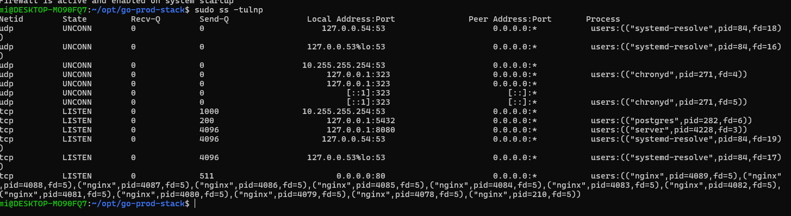
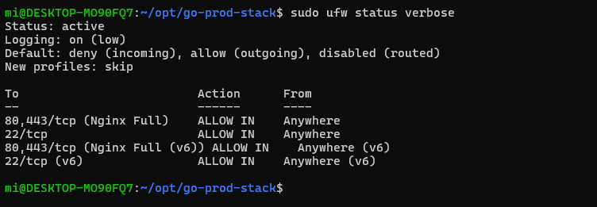
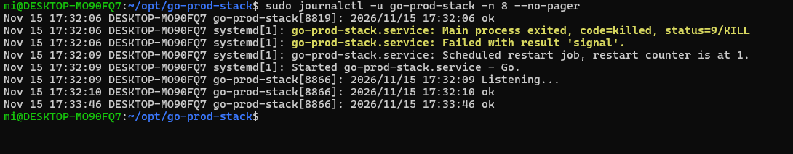

# Go Production Stack (Go + systemd + Nginx + UFW)

End-to-end production deployment of a **Go** backend API on Linux following industry best practices: localhost network isolation, process supervision and hardening via **systemd**, **Nginx** reverse proxy, and **UFW** firewall configuration.

---

## Architecture

```text
[ Client / External Traffic ]
           │
           ▼  (Allowed ports: 80, 443, 22 only)
     [ UFW Firewall ]  ──► Blocks all other incoming traffic (default deny)
           │
           ▼  (0.0.0.0:80)
  [ Nginx Reverse Proxy ]  ──► Forwards X-Real-IP / X-Forwarded-For headers
           │
           ▼  (127.0.0.1:8080 - Loopback interface only)
   [ systemd Service ]  ──► Supervision, privilege isolation & auto-restart
           │
           ▼
     [ Go Binary ]
```

---

## Technical & Security Design

* **Network Isolation (`127.0.0.1:8080`):** The Go application binds strictly to the loopback interface (`localhost`), preventing any direct external access.
* **Reverse Proxy (`Nginx`):** Single public entry point on port `80`, forwarding client identity headers (`X-Real-IP`, `X-Forwarded-For`, `X-Forwarded-Proto`) with the default vhost removed.
* **Supervision & Resilience (`systemd`):** Lifecycle management with automatic crash recovery (`Restart=on-failure`) and privilege hardening.
* **Firewall (`UFW`):** `default deny incoming` policy allowing only web traffic (`Nginx Full`) and SSH administration (`22/tcp`).

---

## Project Structure

```text
.
├── main.go                     # Go API source code (/health endpoint)
├── go.mod                      # Go module definition
├── deploy/
│   ├── go-prod-stack.service   # Hardened systemd unit file
│   └── nginx.conf              # Nginx reverse proxy configuration
├── docs/                       # Audit and resilience screenshots
└── README.md
```

---

## Installation & Deployment

### 1. Build the Go Binary
```bash
go build .
```

### 2. Configure the `systemd` Service
```bash
sudo cp deploy/go-prod-stack.service /etc/systemd/system/
sudo systemctl daemon-reload
sudo systemctl enable --now go-prod-stack
```

### 3. Configure the `Nginx` Reverse Proxy
```bash
sudo cp deploy/nginx.conf /etc/nginx/sites-available/go-prod-stack
sudo ln -s /etc/nginx/sites-available/go-prod-stack /etc/nginx/sites-enabled/
sudo rm -f /etc/nginx/sites-enabled/default
sudo nginx -t && sudo systemctl reload nginx
```

### 4. Enable the `UFW` Firewall
```bash
sudo ufw default deny incoming
sudo ufw default allow outgoing
sudo ufw allow 22/tcp
sudo ufw allow 'Nginx Full'
sudo ufw enable
```

---

## Audit & Resilience Verification

### 1. Network Socket Exposure (`ss -tulnp`)
Verifies that only **Nginx** listens on the public interface (`0.0.0.0:80`), while the **Go** binary remains isolated on localhost (`127.0.0.1:8080`):



### 2. Firewall Rules (`ufw status verbose`)
Confirms the `deny (incoming)` default policy with minimal required ports open:



### 3. Crash Auto-Recovery Test (`SIGKILL` + `curl`)
Simulates an abrupt process termination (`kill -9 $(pidof go-prod-stack)`): `systemd` automatically restarts the service and the `/health` endpoint recovers with `200 OK` through Nginx:


